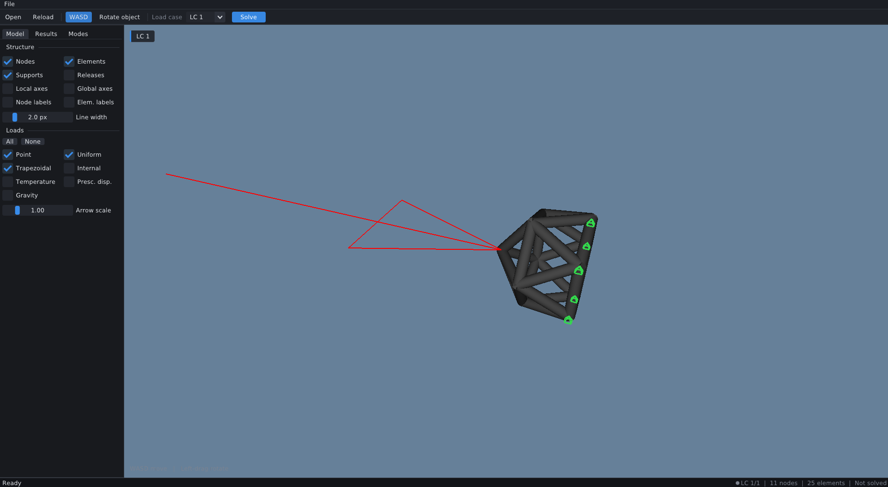
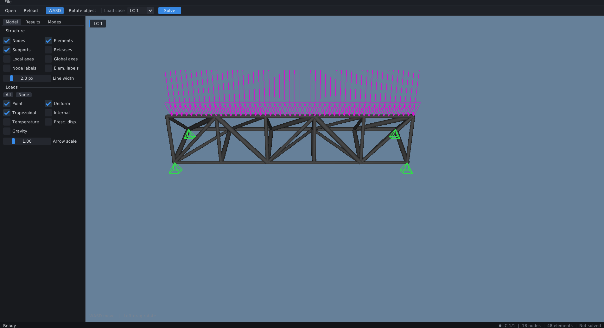
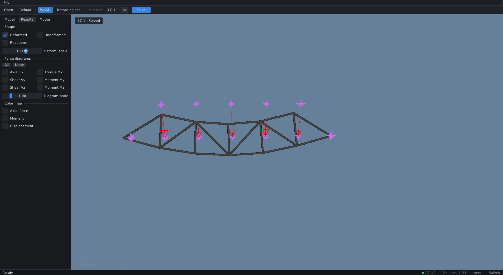

# Frame3DD Viewer

An interactive OpenGL viewer for [Frame3DD](https://github.com/hpgavin/frame3dd), the static and dynamic structural analysis program for 2D and 3D frames and trusses.

Open a `.3dd` model, press **Solve**, and inspect the structure, loads, supports, deformed shape and mode shapes.

This is a stand-alone program. It does not contain the solver: it runs a separately installed `frame3dd`.

> Status: early version, under development. Feedback is welcome.





## Features

- Loads `.3dd` input files (nodes, elements, supports, load cases)
- Draws point, uniform and trapezoidal loads, nodal moments and supports
- Runs the Frame3DD solver and reads the results
- Deformed shape with automatic scaling
- Mode shape animation
- Free orbit camera
- Dear ImGui interface (display options, load case selector, inspector)

## Requirements

- Linux with X11 or XWayland (tested on Ubuntu under WSL2). Windows support is planned.
- A C/C++ compiler and OpenGL 3.3 or newer
- **GLFW 3** (must be installed separately)
- **Frame3DD**, installed separately (see below)

Dear ImGui and cglm are included in the repository.

### Install dependencies

On Ubuntu / Debian / WSL:

```bash
sudo apt update
sudo apt install build-essential git mesa-utils libx11-dev libxrandr-dev libxinerama-dev libxcursor-dev libxi-dev libxext-dev libgl-dev libglfw3-dev
```

The `libglfw3-dev` package provides the GLFW headers and library required to build the viewer. If you prefer, you can download and install GLFW separately from its [official repository](https://github.com/glfw/glfw).

On WSL2, GUI windows need WSLg (Windows 11, or a recent Windows 10 with an up-to-date WSL).

Check OpenGL with `glxinfo -B`; it should report version 3.3 or higher.

## Install Frame3DD

The viewer needs the `frame3dd` executable. Build it from source:

```bash
cd ~
git clone https://github.com/hpgavin/frame3dd
git clone https://github.com/hpgavin/HPGnumlib      # must sit next to frame3dd
cd frame3dd
mkdir -p obj
make
```

The viewer looks for `frame3dd` in this order:

1. The path saved in its settings or chosen in the "Locate Frame3DD" dialog
2. The `FRAME3DD_EXE` environment variable
3. The folder of the viewer's own executable
4. Every folder in `PATH`
5. Common locations, then a search of your home folder

You do not have to put it on `PATH`. If it is not found, the viewer asks you to locate it when you press Solve.

## Build and run

```bash
git clone https://github.com/benaskeurnizar/frame3dd_viewer
cd frame3dd_viewer
bash build.sh
./renderer path/to/model.3dd
```

A prebuilt Linux binary is available under Releases. It needs no `-dev` packages.

The `shaders/` folder must stay next to the `renderer` executable.

## Usage

1. Open a `.3dd` file (File > Open, or pass it on the command line).
2. Pick a load case.
3. Press **Solve**. If the solver is not found, choose the `frame3dd` executable once.
4. Use the Display panel to show loads, supports, the deformed shape or a mode.
5. Mouse: drag to orbit, scroll to zoom.

Example models are in the Frame3DD repository, under `examples/`.

## Notes

- Frame3DD appends results to its output file, so the viewer runs it on a fresh temporary folder for each solve.
- Solver exit code 182 means large strain (an overloaded member). The results are still written.
- In 3D models Z is vertical. In 2D models Y is vertical.
- Linux only (X11 or XWayland).

## Credits and license

Frame3DD is by Henri P. Gavin (Duke University) and is released under the GPL.

This viewer is released under the GNU General Public License v3.0, see `LICENSE`.

Dear ImGui, GLFW and cglm are used under their own licenses.
